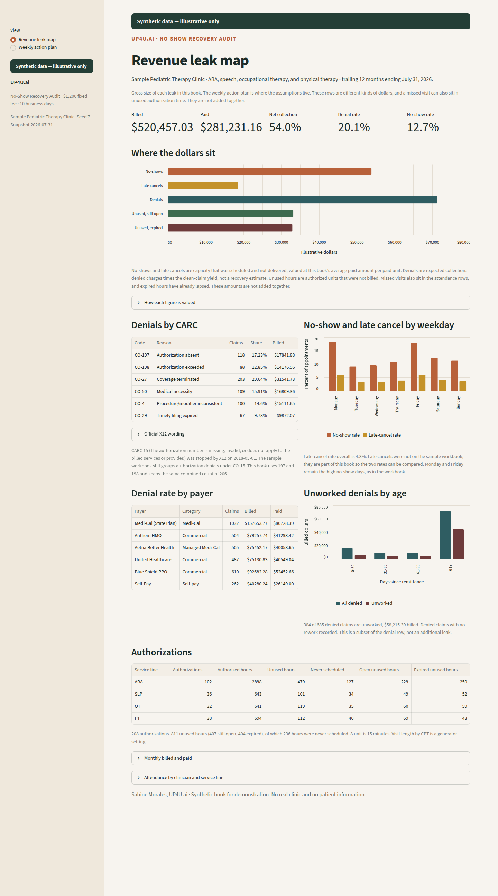
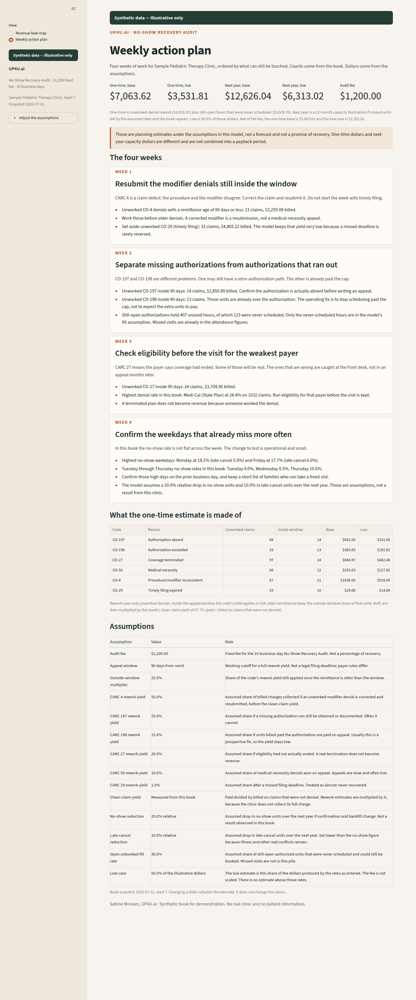

# UP4U.ai — No-Show Recovery Audit

A synthetic revenue-cycle demo for small independent pediatric therapy clinics (ABA, speech, occupational therapy, physical therapy).

**Author:** Sabine Morales, UP4U.ai

UP4U.ai runs a fixed-fee **No-Show Recovery Audit**: **$1,200**, **10 business days**. The audit reads a year of the clinic's own claims, schedule, and authorizations and turns it into a four-week action plan. This repository is that audit, run on a clinic that does not exist, so an owner or a hiring reader can see the method without anyone's patient information.

The app carries a **Synthetic data — illustrative only** banner on every screen.





## The problem

A small therapy clinic loses money in a few ordinary places. A visit is scheduled and no one comes. A visit is cancelled too late to fill. An authorization still has hours on it, or it ran out before the month did. A claim is denied and sits in a queue. None of that requires a new clinical program to see. It requires the clinic's own remits, the schedule, and the authorization log, read together.

The audit does not promise a recovery amount, and this demo does not estimate a payback period.

## What the audit finds

Four piles, kept separate because they are not the same kind of dollar and because a missed visit can also be unused authorization time:

1. **No-shows and late cancels.** Capacity that was on the schedule and was not delivered.
2. **Unused authorizations.** Units that were authorized and not billed, split into hours still inside an open authorization and hours already expired. Hours that were never scheduled are called out separately from missed visits.
3. **Denials, by current CARC.** Why the claim did not pay, in X12's current codes.
4. **Unworked and aged denials.** The subset of denials nobody has touched, by how old the remittance is. This is part of the denial pile, not a fifth leak.

The gross size of a pile is not the amount the audit collects. The action plan applies an explicit set of assumptions to a smaller, workable slice: unworked denials, still-open hours that were never scheduled, and a hypothetical drop in missed visits over the next year.

## The synthetic book

Seed **7**. Trailing twelve months ending **July 31, 2026**. One kept visit is one claim.

| | |
| --- | --- |
| Claims | 3,400 |
| Billed | $520,457.03 |
| Paid | $281,231.16 |
| Net collection (paid ÷ billed) | 54.0% |
| Denial rate | 20.1% (685 claims) |
| No-show rate | 12.7% (520 of 4,094 appointments) |
| Late-cancel rate | 4.3% (174 appointments) |
| Clean-claim yield | 67.7% (paid ÷ billed on claims that were not denied) |
| Patients / authorizations | 104 ids / 208 authorizations |

Service lines are ABA, SLP, OT, and PT. Payers are Medi-Cal (State Plan), Aetna Better Health (labeled here as managed Medi-Cal, which is what that product name refers to), Anthem HMO, United Healthcare, Blue Shield PPO, and self-pay.

Denial rate by payer in this book, worst first:

| Payer | Claims | Billed | Paid | Denial rate |
| --- | ---: | ---: | ---: | ---: |
| Medi-Cal (State Plan) | 1,032 | $157,653.77 | $80,728.39 | 24.4% |
| Anthem HMO | 504 | $79,257.74 | $41,293.42 | 23.8% |
| Aetna Better Health | 505 | $75,452.17 | $40,058.65 | 21.2% |
| United Healthcare | 487 | $75,130.83 | $40,549.04 | 19.7% |
| Blue Shield PPO | 610 | $92,682.28 | $52,452.66 | 16.6% |
| Self-Pay | 262 | $40,280.24 | $26,149.00 | 3.4% |

Denials by current CARC. Descriptions are the X12 sentences (usage notes omitted). Source: [X12 Claim Adjustment Reason Codes](https://x12.org/codes/claim-adjustment-reason-codes).

| Code | Official description | Claims | Share | Billed |
| --- | --- | ---: | ---: | ---: |
| CO-27 | Expenses incurred after coverage terminated. | 203 | 29.6% | $31,541.73 |
| CO-197 | Precertification/authorization/notification/pre-treatment absent. | 118 | 17.2% | $17,841.88 |
| CO-50 | These are non-covered services because this is not deemed a 'medical necessity' by the payer. | 109 | 15.9% | $16,809.36 |
| CO-4 | The procedure code is inconsistent with the modifier used. | 100 | 14.6% | $15,111.65 |
| CO-198 | Precertification/notification/authorization/pre-treatment exceeded. | 88 | 12.8% | $14,176.96 |
| CO-29 | The time limit for filing has expired. | 67 | 9.8% | $9,872.07 |

**CARC 15 was stopped by X12 on May 1, 2018.** Its old text was "The authorization number is missing, invalid, or does not apply to the billed services or provider." The sample workbook this book is built from still groups 206 authorization denials under CO-15. Those 206 are reallocated here to CO-197 (118) and CO-198 (88). CARC 15 is in the code catalog as retired and is not used on any claim. If a clearinghouse report still shows CO-15, it is a legacy mapping, not a current remit code.

Monday and Friday are the high no-show days in this book (18.2% and 17.7%). That weekday pattern is the sample workbook's pattern, carried onto the larger schedule below. It is a fact about this synthetic book, not a published benchmark.

### What was matched, and what was built so the audit could be shown

The sample workbook's claim sheet and the appointment sheet do not share a key: 3,400 claims beside 2,600 appointments. This generator builds one book.

Matched to the cent, or to the claim:

- 3,400 claims, $520,457.03 billed, $281,231.16 paid
- Each payer's claim count, billed amount, paid amount, and denial count
- Each month's billed and paid amounts, August 2025 through July 2026
- 685 denials, with the workbook's counts for CARC 27 (203), 50 (109), 4 (100), and 29 (67)
- The no-show *rate* of 12.7%, and the weekday and clinician no-show rates from the workbook (within half a percentage point)

Built for the audit, and labeled as generator settings rather than measurements from the workbook:

- The schedule has 4,094 appointments so that 3,400 kept visits can each become one claim and the no-show rate can stay 12.7%. Late cancels are 174 of those appointments (4.3%). The workbook did not separate late cancels. Their weekday tilt follows Monday and Friday, the days the workbook already shows as high no-show days.
- Clinicians bill their own discipline. The workbook's 500-row claim sample had every clinician on every CPT; that is not how these credentials bill.
- Authorizations, in 15-minute units, with authorized, used, missed, never-scheduled, and exceeded units.
- A remit lag and an unworked flag, so denials can be aged.

Patient records are ids only (`SC-001`). There are no names, birth dates, addresses, member numbers, or diagnoses. Clinician labels (`R. Kim, OTR/L` and the others) are the synthetic labels from the sample workbook, not real people.

## Illustrative dollars

Under the default assumptions, which are editable in the app:

| | Base | Low (half) |
| --- | ---: | ---: |
| One-time: rework unworked denials | $4,053.92 | |
| One-time: fill still-open hours that were never scheduled | $3,009.70 | |
| **One-time total** | **$7,063.62** | **$3,531.81** |
| Next year: fewer no-shows, if the book repeats | $10,782.70 | $5,391.35 |
| Next year: fewer late cancels, if the book repeats | $1,843.34 | $921.67 |
| **Next-year capacity** | **$12,626.04** | **$6,313.02** |
| Audit fee | $1,200.00 | $1,200.00 |
| One-time total net of the fee | $5,863.62 | $2,331.81 |

The one-time figure and the next-year figure are different kinds of dollars. They are not added, and they are not turned into a payback period. The low column is half of the illustrative dollars, not a second study, and there is no column above the assumptions as entered.

Gross context, so the smaller estimate has something to sit against. These are not added to the table above.

- No-show capacity, if every missed unit had been paid like an average paid unit: $53,913.51
- Late-cancel capacity, same valuation: $18,433.36
- Denied charges: $105,353.65 billed, or $71,376.75 valued at the 67.7% clean-claim yield
- Unused authorization time: about $33,196 still open and $32,952 already expired
- Unworked denials: 384 of the 685, $58,215.39 billed, most of it older than 90 days

Most of the denied dollars are old. The week's work is the fresh queue, not the whole year of write-offs.

## How to run

Python 3.11 or newer.

```bash
python -m venv .venv
source .venv/bin/activate
pip install -r requirements-dev.txt
pytest
PYTHONPATH=src python -m up4u_audit
streamlit run app.py
```

`pytest` uses `pytest.ini`, which puts `src` on the path. The summary command prints the headline figures for seed 7. The app is `app.py`. The sidebar switches between the revenue leak map and the weekly action plan. On the action plan, **Adjust the assumptions** rebuilds the estimate without changing the claims.

An editable install also works: `pip install -e ".[dev]"`, after which `python -m up4u_audit` does not need `PYTHONPATH`.

## Method and assumptions

### How a dollar in the leak map is valued

- A **paid unit** is one 15-minute block on a claim with a payment. The book's average is the rate used for no-shows, late cancels, and unused units. Choosing that rate is an assumption; the rate itself is measured from this book.
- A **denial's expected collection** is its billed charge times the clean-claim yield (paid ÷ billed on claims that were not denied). That yield is 67.7% in this book. It is not a fee schedule.
- **Unworked** means the denial has no rework recorded. Paid claims are marked worked because they are closed.

### Generator settings

These are choices in `src/up4u_audit/targets.py`. They are not clinic measurements and they are not industry rates.

- Claim charges fall between $65 and $240, and the payer and month totals are exact.
- A non-denied claim pays between 50% and 85% of its charge. The payer and month paid totals are exact. Denied claims pay $0. Allowed amounts sit just above paid, in the neighborhood of the sample's paid-to-allowed ratio.
- BCBA visits are split 15% / 20% / 45% / 20% across CPT 97151 / 97153 / 97155 / 97156. An RBT bills 97153. Speech bills 92507, OT bills 97535, PT bills 97110.
- Visit length, in 15-minute units: 8 for 97151 and 97153, 4 for the other codes in this book.
- Late-cancel weekday weights: Monday 1.6, Tuesday 0.8, Wednesday 0.8, Thursday 0.9, Friday 1.6, Saturday 1.0, Sunday 0.9, scaled to 174 visits.
- Share of denials left unworked, by age of the remittance: 35% at 0–30 days, 45% at 31–60, 55% at 61–90, 62% at 91 or more.
- Remit lag is 18 to 35 days after the visit, and not later than the snapshot date.
- On an authorization that was not exceeded, unused units are missed visits in that period plus 4, 8, or 16 units (1, 2, or 4 hours) that were never scheduled. An authorization with a CARC 198 claim is reported as exceeded; its unused hours are not also counted.

### Recovery assumptions

Defaults in `RoiAssumptions`. Each one is an assumption about what a clinic might collect or free up if it did the work. None of them is a published success rate.

| Assumption | Default | What it does |
| --- | --- | --- |
| Audit fee | $1,200 | Fixed. Not a percentage of recovery. |
| Appeal window | 90 days from remit | Working cutoff for a full yield. Not a payer's legal deadline. |
| Outside-window multiplier | 25% | Share of the code's yield still applied after the window. |
| CARC 4 yield | 55% of billed | A modifier mismatch is often a correction and a resubmission. |
| CARC 197 yield | 25% of billed | A missing authorization can sometimes be documented. Often it cannot. |
| CARC 198 yield | 15% of billed | Units already over the cap. The fix is mostly prospective. |
| CARC 27 yield | 20% of billed | Only the cases where coverage had not actually ended. |
| CARC 50 yield | 10% of billed | Medical-necessity appeals are slow and often lost. |
| CARC 29 yield | 2% of billed | A missed filing deadline is treated as almost never recovered. |
| Clean-claim yield | Measured (67.7%) | Multiplies every rework estimate. The clinic does not collect its full charge. |
| No-show reduction | 20% relative | Assumed drop in no-show units over the next year. Not a result from this book. |
| Late-cancel reduction | 10% relative | Lower than the no-show figure, because real conflicts remain. |
| Open unbooked fill | 30% | Share of still-open, never-scheduled units assumed bookable. Missed visits are not in this pile. |
| Low case | 50% of the illustrative dollars | The fee is not halved. There is no case above the rates as entered. |

Rework is computed only on **unworked** denials. A denial inside the window contributes `billed × yield × clean-claim yield`. A denial outside the window contributes that amount times 25%. Filling an open unbooked unit, and avoiding a missed unit next year, are valued at the book's average paid amount per unit.

## Synthetic data

Every row is produced by `up4u_audit.generator.generate` from seed 7. There are no real patients and no protected health information. Do not load a real remit, schedule, or authorization file into this app. The sample workbook's summary totals live in `src/up4u_audit/targets.py`. The workbook is not included.

## Tests

`pytest` covers the generator (totals, CARC counts, the retired status of CARC 15, attendance rates, authorization identities, patient ids), the leak map, and the recovery model (zero rates produce zero illustrative dollars, a higher CARC 4 yield moves only that code, the model states that it is not a promise). GitHub Actions runs the same suite on Python 3.12.

## License

MIT. See [LICENSE](LICENSE).
